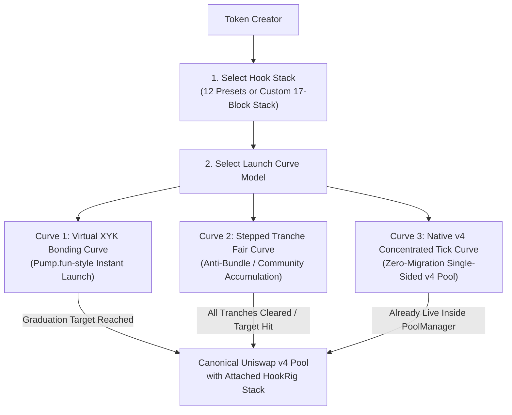

# 01. Explanation, Building Blocks, Presets & Token Launchpad

## 1. Executive Summary & Vision

**`hookrig`** is a modular, security-first smart contract framework for **Uniswap v4** that combines two core pillars:

1. **Composable Hook Building Blocks**: Instead of writing monolithic, brittle custom hooks from scratch, builders assemble hooks from **17 standardized, audited building blocks** organized into **5 functional groups**, or pick from **12 battle-tested presets**.
2. **Native Token Launchpad Family (3 Curve Models)**: Creators can launch a new token on one of **3 bonding/launch curves** directly bound to either a known `hookrig` preset or a custom-composed hook stack—seamlessly transitioning from token creation and initial price discovery into a full-featured Uniswap v4 pool.

### Core Design Philosophy
- **Stackable Without Collisions**: Every block has a strictly defined callback footprint, isolated per-pool state (`PoolId`), and deterministic rules for combining fees (`beforeSwap`) and output deltas (`afterSwapReturnDelta`).
- **Explicit Trust Labeling**: Every block is classified by its trust assumption (**Low / Trustless** vs. **Medium / Parameterized or Managed**) so traders, LPs, and integrators can verify risk on-chain.
- **Built on Audited Foundations**: Anchored on Foundry, `Uniswap/v4-core`, and `OpenZeppelin/uniswap-hooks` (`BaseHook`, `CurrencySettler`, `BaseCustomCurve`, `BaseDynamicFee`).

---

## 2. Base Templates & Callback Overview

Before stacking blocks, `hookrig` defines the base callback capabilities available to any hook configuration:

| Template | Default Callbacks | Trust | Settings / Key Parameters |
| :--- | :--- | :--- | :--- |
| **Dynamic fee** | `afterInitialize`, `beforeSwap` | Low | Base fee, max fee, volatility window |
| **Managed fee** | `afterInitialize` | Medium (manager can update fee) | Starting fee, hard fee cap |
| **Market-hours fee** | `afterInitialize`, `beforeSwap` | Low | Open fee, closed fee, opening & closing hour (UTC) |
| **Anti-snipe** | `afterInitialize`, `beforeSwap` | Low | Launch fee decaying to normal fee over $N$ blocks |
| **MEV protection** | `beforeSwap`, `afterSwap` | Low | Max price impact per block, cooldown / JIT guards |
| **Arb recapture** | `beforeSwap`, `afterSwap`, `afterSwapReturnDelta` | Medium | Share of arbitrage profit captured and paid to LPs |
| **Access control** | `beforeAddLiquidity` and/or `beforeSwap` | Medium | Allowlist / Merkle root / verifier scope (LP vs. Swapper) |
| **Wallet cap** | `beforeSwap`, `afterSwap` | Low | Max token balance or buy volume per wallet as % of supply |
| **Buy and sell tax** | `afterSwap`, `afterSwapReturnDelta` | Medium | Buy tax bps, sell tax bps, tax recipient address |
| **Auto burn** | `afterSwap`, `afterSwapReturnDelta` | Medium | % of each buy automatically burned (`0xdead` or `burn()`) |
| **Fee sharing** | `afterSwap`, `afterSwapReturnDelta` | Medium | Protocol/creator split bps, recipient split addresses |
| **LP rewards** | `afterSwap`, `afterSwapReturnDelta` | Medium | Extra fee on buys, donated directly to in-range LPs (`PoolManager.donate`) |
| **Swap rewards** | `afterSwap` | Low | Reward points / emissions accrued per swap volume |
| **King of the Pool** | `afterSwap`, `afterSwapReturnDelta` | Medium | Pot fee on buys, countdown round length, last-buyer payout |
| **Limit orders** | `afterInitialize`, `afterSwap` | Low | Tick-aligned on-chain limit order placement and settlement |
| **TWAMM** | `beforeInitialize`, `beforeAddLiquidity`, `beforeSwap` | Low | Time-Weighted Average Market Maker virtual order streaming |
| **Oracle** | `afterInitialize`, `beforeAddLiquidity`, `beforeRemoveLiquidity`, `beforeSwap` | Low | Truncated geometric/tick TWAP & volatility checkpointing |
| **Blank** | None (user selects blocks freely) | Configurable | Custom user-defined stack of the 17 blocks |

---

## 3. The 17 Composable Building Blocks (`blocks.ts` Specification)

Every hook in `hookrig` is constructed as an ordered subset of the **17 canonical blocks**, grouped into 5 functional domains:

```mermaid
flowchart LR
    subgraph G1["1. Fees (beforeSwap)"]
        B1["Dynamic fee"]
        B2["Managed fee"]
        B3["Market-hours fee"]
    end
    subgraph G2["2. Protection & Access"]
        B4["Anti-snipe"]
        B5["MEV protection"]
        B6["Arb recapture"]
        B7["Access control"]
    end
    subgraph G3["3. Token Rules"]
        B8["Wallet cap"]
        B9["Buy & sell tax"]
        B10["Auto burn"]
    end
    subgraph G4["4. Rewards & Income (afterSwap)"]
        B11["Fee sharing"]
        B12["LP rewards"]
        B13["Swap rewards"]
        B14["King of the Pool"]
    end
    subgraph G5["5. Trading Primitives"]
        B15["Limit orders"]
        B16["TWAMM"]
        B17["Oracle"]
    end
    G1 --> G2 --> G3 --> G4 --> G5
```

### Canonical Block Matrix

| # | Group | Block ID | Block Name | Required Callbacks | Uses Return Delta? | Trust Level |
| :--- | :--- | :--- | :--- | :--- | :--- | :--- |
| **1** | **Fees** | `dynamic_fee` | **Dynamic fee** | `afterInitialize`, `beforeSwap` | No (`lpFeeOverride`) | Low |
| **2** | **Fees** | `managed_fee` | **Managed fee** | `afterInitialize` | No (`updateDynamicLPFee`) | Medium |
| **3** | **Fees** | `market_hours_fee` | **Market-hours fee** | `afterInitialize`, `beforeSwap` | No (`lpFeeOverride`) | Low |
| **4** | **Protection & Access** | `anti_snipe` | **Anti-snipe** | `afterInitialize`, `beforeSwap` | No (`lpFeeOverride`) | Low |
| **5** | **Protection & Access** | `mev_protection` | **MEV protection** | `beforeSwap`, `afterSwap` | No | Low |
| **6** | **Protection & Access** | `arb_recapture` | **Arb recapture** | `beforeSwap`, `afterSwap`, `afterSwapReturnDelta` | Yes (`afterSwap`) | Medium |
| **7** | **Protection & Access** | `access_control` | **Access control** | `beforeAddLiquidity` and/or `beforeSwap` | No | Medium |
| **8** | **Token Rules** | `wallet_cap` | **Wallet cap** | `beforeSwap`, `afterSwap` | No | Low |
| **9** | **Token Rules** | `buy_sell_tax` | **Buy and sell tax** | `afterSwap`, `afterSwapReturnDelta` | Yes (`afterSwap`) | Medium |
| **10** | **Token Rules** | `auto_burn` | **Auto burn** | `afterSwap`, `afterSwapReturnDelta` | Yes (`afterSwap`) | Medium |
| **11** | **Rewards & Income** | `fee_sharing` | **Fee sharing** | `afterSwap`, `afterSwapReturnDelta` | Yes (`afterSwap`) | Medium |
| **12** | **Rewards & Income** | `lp_rewards` | **LP rewards** | `afterSwap`, `afterSwapReturnDelta` | Yes (`afterSwap`) | Medium |
| **13** | **Rewards & Income** | `swap_rewards` | **Swap rewards** | `afterSwap` | No | Low |
| **14** | **Rewards & Income** | `king_of_the_pool` | **King of the Pool** | `afterSwap`, `afterSwapReturnDelta` | Yes (`afterSwap`) | Medium |
| **15** | **Trading** | `limit_orders` | **Limit orders** | `afterInitialize`, `afterSwap` | No | Low |
| **16** | **Trading** | `twamm` | **TWAMM** | `beforeInitialize`, `beforeAddLiquidity`, `beforeSwap` | No (executes virtual swaps) | Low |
| **17** | **Trading** | `oracle` | **Oracle** | `afterInitialize`, `beforeAddLiquidity`, `beforeRemoveLiquidity`, `beforeSwap` | No | Low |

---

## 4. The 12 Curated Presets (`presets.ts` Specification)

Rather than forcing users to design hooks from scratch, `hookrig` ships with **12 curated, domain-specific presets** composed directly from the 17 blocks:

| # | Preset Name | Target Use Case | Composed Blocks | Combined Callbacks Union |
| :--- | :--- | :--- | :--- | :--- |
| **1** | **Fair launch** | Community token launches with anti-bot protection, whale caps, deflation, and LP yield | `Dynamic fee` + `Anti-snipe` + `Wallet cap` + `Auto burn` + `LP rewards` | `afterInitialize`, `beforeSwap`, `afterSwap`, `afterSwapReturnDelta` |
| **2** | **King of the Pool launch** | Gamified token launch where buys feed a rolling jackpot and LPs earn arb/buy yield | `Dynamic fee` + `Anti-snipe` + `Arb recapture` + `LP rewards` + `King of the Pool` | `afterInitialize`, `beforeSwap`, `afterSwap`, `afterSwapReturnDelta` |
| **3** | **Weekly King with buy rewards** | Long-horizon (168-hour round) jackpot pool with continuous swap loyalty points | `Dynamic fee` + `Anti-snipe` + `Arb recapture` + `LP rewards` + `King of the Pool` (168h) + `Swap rewards` | `afterInitialize`, `beforeSwap`, `afterSwap`, `afterSwapReturnDelta` |
| **4** | **Creator economy token** | Sustainable creator revenue via buy/sell tax + fee sharing alongside LP incentives | `Dynamic fee` + `Anti-snipe` + `Buy and sell tax` + `Fee sharing` + `LP rewards` | `afterInitialize`, `beforeSwap`, `afterSwap`, `afterSwapReturnDelta` |
| **5** | **Charity token** | Automated impact/cause funding via fee sharing + deflationary burns + LP rewards | `Dynamic fee` + `Anti-snipe` + `Fee sharing` + `LP rewards` + `Auto burn` | `afterInitialize`, `beforeSwap`, `afterSwap`, `afterSwapReturnDelta` |
| **6** | **Treasury-backed token** | Protocol treasury protection (sell-only tax + arb recapture + burn + LP rewards) | `Dynamic fee` + `Anti-snipe` + `Arb recapture` + `Buy and sell tax` *(sell only)* + `LP rewards` + `Auto burn` | `afterInitialize`, `beforeSwap`, `afterSwap`, `afterSwapReturnDelta` |
| **7** | **Stock-quoted token** | RWA / equity-hours token charging higher spread outside UTC market hours | `Market-hours fee` + `Anti-snipe` + `Arb recapture` + `LP rewards` + `Auto burn` | `afterInitialize`, `beforeSwap`, `afterSwap`, `afterSwapReturnDelta` |
| **8** | **Deep liquidity (existing token)** | Secondary/migrated pools for established tokens maximizing LP profitability | `Dynamic fee` + `Arb recapture` + `LP rewards` | `afterInitialize`, `beforeSwap`, `afterSwap`, `afterSwapReturnDelta` |
| **9** | **Trader-first pools** | Low-friction execution with launch protection and LVR recapture | `Dynamic fee` + `Anti-snipe` + `Arb recapture` | `afterInitialize`, `beforeSwap`, `afterSwap`, `afterSwapReturnDelta` |
| **10** | **Stable-pair project fee** | Pegged/correlated pairs with symmetric 1.875% tax + arb recapture + LP rewards | `Arb recapture` + `Buy and sell tax` *(1.875% each way)* + `LP rewards` | `beforeSwap`, `afterSwap`, `afterSwapReturnDelta` |
| **11** | **Private pool (ours)** | Institutional / KYC / permissioned pools with sandwich protection and TWAP oracle | `Access control` + `MEV protection` + `Oracle` | `afterInitialize`, `beforeAddLiquidity`, `beforeRemoveLiquidity`, `beforeSwap`, `afterSwap` |
| **12** | **Pro trading pool (ours)** | Full-featured exchange pool with on-chain limit orders, TWAMM, dynamic fee, and oracle | `Dynamic fee` + `Limit orders` + `TWAMM` + `Oracle` | `beforeInitialize`, `afterInitialize`, `beforeAddLiquidity`, `beforeRemoveLiquidity`, `beforeSwap`, `afterSwap` |

---

## 5. The Token Launchpad Family (3 Curve Architectures)

Because users launching tokens want seamless integration between **token creation**, **initial price discovery (bonding curve)**, and **ongoing Uniswap v4 trading with custom hooks**, `hookrig` includes a first-class **Token Launchpad Suite** with **3 curve archetypes**.

Every launch binds the newly minted ERC-20 token to either one of the **12 Presets** or a **custom-composed Hook Stack**:

### Model 1: `VirtualXYKLaunch` (Classic Pump.fun-Style Virtual Constant-Product Curve)
- **How It Works**:
  - Mints fixed total supply (e.g., `1,000,000,000` tokens). Roughly 80% is allocated to the bonding curve and 20% reserved for graduated Uniswap v4 liquidity.
  - Trades against virtual reserves $(R_{\text{virtualQuote}} + R_{\text{realQuote}}) \cdot R_{\text{token}} = k$ with zero upfront capital required from the creator.
  - Once `realQuote` reaches `graduationThreshold` (e.g., $4.2\text{ ETH}$ or equivalent USDC), the curve automatically **graduates**: it initializes the target Uniswap v4 `PoolKey` with the chosen `hookrig` hook address, seeds the raised quote + reserved tokens as permanent full-range liquidity (burning the LP NFT/claims), and activates the hook's `Anti-snipe` / `Dynamic fee` / `King of the Pool` rules.
- **Best Paired With**: *Fair launch*, *King of the Pool launch*, *Creator economy token*, *Charity token*.

### Model 2: `SteppedTrancheLaunch` (Piecewise Linear / Exponential Anti-Bot Accumulation Curve)
- **How It Works**:
  - Divides the bonding phase into $M$ discrete price steps/tranches (or time-damped exponential bonding steps) with native **per-wallet allocation caps** (`Wallet cap`) and **early-block sniper surcharges** (`Anti-snipe`) enforced *during* the bonding phase itself.
  - Prevents single-block flashbot bundles from buying 80% of the curve in the creation block. Excess fee surcharges collected from fast buyers during the curve phase are injected directly into the graduation LP reserve or the initial `King of the Pool` jackpot pot.
- **Best Paired With**: *Weekly King with buy rewards*, *Treasury-backed token*, *Fair launch*.

### Model 3: `NativeTickLaunch` (Zero-Migration Direct Uniswap v4 Concentrated Curve)
- **How It Works**:
  - Eliminates the bonding-curve-to-DEX migration gap entirely.
  - At token creation, the canonical Uniswap v4 pool is initialized immediately at the starting tick with the chosen `hookrig` hook attached from block 0.
  - Single-sided token supply is deposited across $K$ adjacent concentrated liquidity tick ranges above (or below) the starting tick following a geometric/bonding density profile.
  - Traders buy directly through `PoolManager.swap()`, meaning **all 17 `hookrig` blocks** (`Auto burn`, `LP rewards`, `Buy and sell tax`, `King of the Pool`, `Swap rewards`) work from the very first trade with zero graduation downtime or migration MEV vector.
- **Best Paired With**: *Pro trading pool*, *Deep liquidity*, *Trader-first pools*, *Stock-quoted token*.

> For the full mathematical specification, graduation state machine, and audited launchpad dependency stack, see [**05. Token Launchpad Mechanics & Audited Stack**](file:///Users/eabz/Documents/GitHub/hookrig/docs/05-token-launch-mechanics.md).

---

## 6. Recommended Expansion Templates & Blocks (Optional Additions)

Beyond the core 17 blocks and 12 presets, the following **5 additional building blocks** fit naturally into the `hookrig` callback architecture without introducing `beforeSwapReturnDelta` conflicts:

| # | Proposed Block | Group | Callbacks | Trust | Why It Adds High Value |
| :--- | :--- | :--- | :--- | :--- | :--- |
| **18** | **JIT Liquidity Guard (`jit_guard`)** | Protection & Access | `beforeAddLiquidity`, `beforeRemoveLiquidity` | Low | Prevents MEV bots from adding single-block Just-In-Time (JIT) liquidity right before a large swap to steal `LP rewards` or `Arb recapture` donations and exiting in the same block. Enforces a minimum $N$-block LP cooldown or charges an early-exit penalty donated to remaining LPs. |
| **19** | **Circuit Breaker / Price Band (`circuit_breaker`)** | Protection & Access | `beforeSwap`, `afterSwap` | Low | Halts trading or spikes the dynamic fee to max if spot tick moves more than $\pm X$ ticks within a rolling time window. Essential for **Stock-quoted tokens (RWAs)**, **Stable-pair pools**, and **Treasury-backed tokens**. |
| **20** | **Referral & Affiliate Split (`referral_split`)** | Rewards & Income | `afterSwap`, `afterSwapReturnDelta` | Low | Reads a referrer address from `hookData`, gives the swapper a basis-point fee rebate, and credits the referrer's ERC-6909 claim balance. High-growth primitive for consumer apps and token launches. |
| **21** | **Vesting / Daily Sell Cap (`sell_cooldown`)** | Token Rules | `beforeSwap` | Low | Caps how much of a wallet's balance can be sold per 24-hour epoch (e.g., max $10\%$ of holdings per day) for team, presale, or airdrop wallets—preventing single-candle cliff dumps on-chain. |
| **22** | **Buyback & Floor Defense (`auto_buyback`)** | Rewards & Income | `afterSwap`, `afterSwapReturnDelta` | Medium | Accumulates quote-currency tax into an internal pool reserve and automatically executes twap/band-triggered buybacks + burns whenever spot price drops below a trailing floor tick. |

