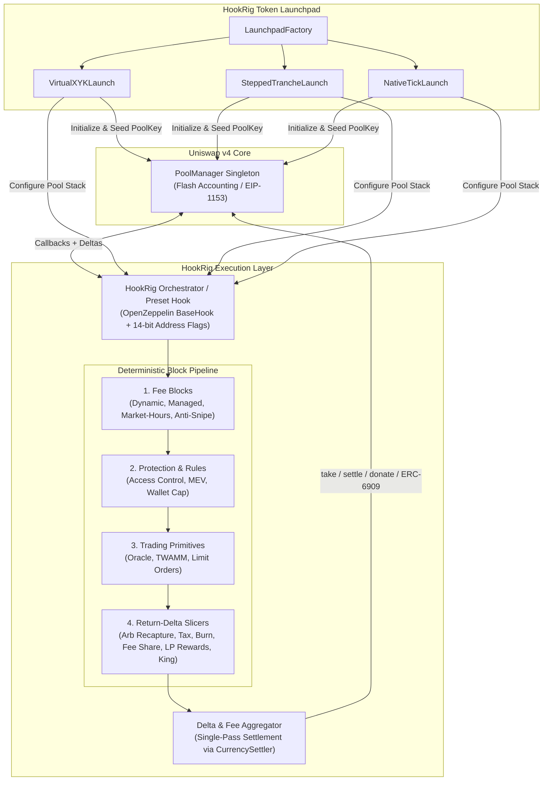

# 02. System Architecture

## 1. High-Level Architectural Overview

`hookrig` is architected around a strict separation between:
1. **The Core Hook Orchestrator (`HookRigMasterHook` / Compiled Preset Hooks)**: The single contract address registered in a Uniswap v4 `PoolKey` whose 14-bit address flags match the union of enabled callbacks.
2. **The 17 Modular Building Blocks (`src/blocks/`)**: Self-contained, per-`PoolId` isolated logic modules grouped into 5 execution categories (`Fees`, `Protection & Access`, `Token Rules`, `Rewards & Income`, `Trading`).
3. **The Settlement & Accounting Layer (`CurrencySettler` + `ERC-6909` Vault)**: Handles all delta resolution, LP donations, token burns, fee splits, and jackpot pots inside a single atomic pass per swap.
4. **The Token Launchpad Factory & Curve Engines (`src/launchpad/`)**: Deploys tokens, manages the 3 launch curves (`VirtualXYKLaunch`, `SteppedTrancheLaunch`, `NativeTickLaunch`), and wires pools to their configured `hookrig` stack.



---

## 2. Two Deployment Modes for Hooks: Orchestrator vs. Compiled Presets

To serve both no-code token creators (who want instant gas-efficient deployment) and advanced protocols (who want custom block combinations), `hookrig` supports two complementary deployment patterns sharing the exact same block libraries:

### Mode A: Singleton Multi-Pool Orchestrator (`HookRigOrchestrator`)
- A pre-deployed, CREATE2-mined singleton hook contract that configures a per-`PoolId` **Block Bitmap** (`uint32 enabledBlocks`) during `beforeInitialize` / `afterInitialize`.
- **Pros**: Zero CREATE2 salt mining needed for new pools; instant one-click pool + token launch.
- **How Callback Flags Work**: Because `PoolManager` inspects the hook contract's address bits, `HookRig` deploys a small set of canonical Orchestrator instances mined for the exact callback bitmasks used by our presets/stacks (e.g., Standard Launch Mask `afterInitialize | beforeSwap | afterSwap | afterSwapReturnDelta`, Pro Trading Mask adding `beforeInitialize | beforeAddLiquidity | beforeRemoveLiquidity`).

### Mode B: Dedicated Compiled Preset Hooks (`src/presets/`)
- Each of the **12 Presets** can also be deployed as a standalone, immutable contract inheriting only the internal block libraries required by that preset.
- **Pros**: Eliminates dynamic bitmap dispatch and cross-contract calls; lowest possible gas per swap (~15–25% gas savings over dynamic dispatch).

---

## 3. Repository & Directory Structure

The repository is organized as follows:

```text
hookrig/
├── docs/                                  # Complete architectural & security specifications
│   ├── 01-explanation-and-catalog.md
│   ├── 02-architecture.md
│   ├── 03-hooks-flow.md
│   ├── 04-security-mechanics-and-caveats.md
│   ├── 05-token-launch-mechanics.md
│   └── 06-deployments.md
├── src/
│   ├── HookRigOrchestrator.sol            # Master composable Uniswap v4 hook orchestrator
│   ├── interfaces/
│   │   ├── IHookRigBlock.sol              # Standardized interface & structs for all 22 blocks
│   │   ├── IHookRigOrchestrator.sol       # Pool configuration & block bitmap registry
│   │   └── ITokenLaunchpad.sol            # Shared interface for the 3 launch curves
│   ├── base/
│   │   ├── HookRigBase.sol                # Extends OpenZeppelin BaseHook + PoolId isolation + Protocol Royalty
│   │   ├── FeeAggregator.sol              # Deterministic resolution of beforeSwap fees
│   │   └── AfterSwapDeltaAggregator.sol   # Single-pass output delta slicing & settlement
│   ├── blocks/
│   │   ├── fees/                          # Group 1: DynamicFee, ManagedFee, MarketHoursFee
│   │   ├── protection/                    # Group 2: AntiSnipe, MEVProtection, ArbRecapture, AccessControl, JITGuard, CircuitBreaker
│   │   ├── token-rules/                   # Group 3: WalletCap, BuySellTax, AutoBurn, VestingSellCap
│   │   ├── rewards/                       # Group 4: FeeSharing, LPRewards, SwapRewards, KingOfThePool, ReferralSplit, AutoBuyback
│   │   └── trading/                       # Group 5: LimitOrders, TWAMM, Oracle
│   ├── presets/                           # The 12 pre-composed Preset Hook contracts
│   ├── launchpad/
│   │   ├── LaunchpadFactory.sol           # Token + Curve + HookKey deployment coordinator
│   │   ├── HookRigToken.sol               # Audited ERC-20 with burn & launchpad hooks
│   │   └── curves/
│   │       ├── VirtualXYKLaunch.sol       # Curve 1: Pump-style virtual constant product
│   │       ├── SteppedTrancheLaunch.sol   # Curve 2: Stepped anti-bot fair accumulation
│   │       └── NativeTickLaunch.sol       # Curve 3: Direct v4 single-sided tick curve
│   └── libraries/
│       ├── PoolTokenDir.sol               # Identifies project token vs quote currency (buy vs sell)
│       ├── TransientContext.sol           # EIP-1153 per-PoolId transient swap context
│       └── HookPermissionMasks.sol        # 14-bit address flags & Tier-3 mutex validator (2,843 valid stacks)
└── test/
    ├── unit/                              # Isolated tests for all 22 blocks
    ├── presets/                           # Integration & security vector tests for all 12 presets
    ├── launchpad/                         # Full lifecycle tests for the 3 launch curves + graduation
    ├── invariant/                         # Foundry stateful invariant fuzzing
    ├── integration/                       # Hoodi fork & exhaustive 2,843 Tier-3 combination verification
    └── fizz/                              # Medusa & Echidna property-based fuzzing harness (56 properties)
```

---

## 4. Core Architectural Primitives

### 4.1 Buy vs. Sell Direction Normalization (`PoolTokenDir`)
Many blocks (`Buy and sell tax`, `Auto burn`, `LP rewards`, `King of the Pool`, `Wallet cap`) distinguish between a **Buy** (acquiring the project token) and a **Sell** (disposing of the project token).
Because Uniswap v4 sorts currencies numerically (`currency0 < currency1`), the project token may be either `currency0` or `currency1`:
- Each pool registers `bool isToken0ProjectToken` at initialization.
- **`isBuy(zeroForOne, isToken0ProjectToken)`**:
  - If `projectToken == currency1`: `zeroForOne == true` (paying `currency0` to receive `currency1`) is a **Buy**.
  - If `projectToken == currency0`: `zeroForOne == false` (paying `currency1` to receive `currency0`) is a **Buy**.
- This normalization guarantees every block behaves identically regardless of token address sort order.

### 4.2 Per-`PoolId` Isolated Storage Pattern
No block in `hookrig` ever uses global state. All persistent state is isolated by `PoolId = key.toId()`:
```solidity
mapping(PoolId poolId => PoolConfig config) internal _poolConfigs;
mapping(PoolId poolId => DynamicFeeState state) internal _dynamicFeeState;
mapping(PoolId poolId => KingPotState pot) internal _kingState;
```
Furthermore, any tokens held by `hookrig` (such as `King of the Pool` jackpot pots, uncollected `Fee sharing` balances, or active `Limit orders` / `TWAMM` escrows) are held as **ERC-6909 claims inside `PoolManager`** and accounted per-`PoolId` in storage—eliminating cross-pool reserve commingling.

### 4.3 Transient Swap Context (`EIP-1153`)
Blocks like `MEV protection`, `Arb recapture`, and `Wallet cap` need to compare pre-swap state (`beforeSwap`) against post-swap state (`afterSwap`):
- In `beforeSwap`, the orchestrator records pre-swap `sqrtPriceX96`, `tick`, and `block.number` into a `PoolId`-namespaced transient storage slot (`TransientSlot`).
- In `afterSwap`, blocks read this transient snapshot to compute exact tick traversal, arbitrage spread, and output amounts, and then **explicitly zero the transient slot** before returning so multi-hop or batched swaps inside the same `unlock()` transaction never read stale transient data.

### 4.4 Tier 3 Block Compatibility & Mutual-Exclusion Architecture (`2,843` Valid Stacks)
To guarantee that custom block stacks never suffer from silent fee overrides, duplicate cooldowns, or contradictory price-dislocation rules, HookRig defines a **Tier 3 Mutual-Exclusion Matrix** across the 22 blocks:
1. **Mutex M1 — Base LP Fee (`<= 1 of 3`)**: `DynamicFee`, `ManagedFee`, and `MarketHoursFee` are mutually exclusive; `AntiSnipe` is only valid as a decay overlay on `DynamicFee` or `MarketHoursFee`.
2. **Mutex M2 & M3 — Dislocation & JIT Guard (`7` valid states)**: `ArbRecapture`, `MEVProtection`, and `CircuitBreaker` are mutually exclusive (`<= 1 of 3`), and `MEVProtection` cannot combine with `JITGuard` (`<= 1 of 2`).
3. **Mutex M4 — Holder / Dump Cap (`<= 1 of 2`)**: `WalletCap` and `VestingSellCap` are mutually exclusive.
4. **Mutex M5 & M6 — Sink, Revenue & LP/Trader Yield (`21` valid states)**: `AutoBurn`, `KingOfThePool`, `ReferralSplit`, and `AutoBuyback` are mutually exclusive (`<= 1 of 4`); `SwapRewards` cannot combine with `BuySellTax` or `FeeSharing`; any active Sink or Revenue block requires `LPRewards`.
5. **Mutex M7 — Archetype Separation**: Retail Tokenomics/Launchpad blocks (`AntiSnipe`, `WalletCap`, `VestingSellCap`, `BuySellTax`, `AutoBurn`, `FeeSharing`, `LPRewards`, `SwapRewards`, `KingOfThePool`, `ReferralSplit`, `AutoBuyback`) and Institutional/Pro-Trading blocks (`AccessControl`, `LimitOrders`, `TWAMM`, `Oracle`) belong to disjoint pool archetypes (`2,645` Retail combinations + `198` Institutional/Pro combinations = **`2,843` total valid stacks**, including all 12 curated Presets).

---

## 5. Dependency Stack

| Layer | Package | Version / Target | Purpose |
| :--- | :--- | :--- | :--- |
| **Compiler & EVM** | `solc` via Foundry | `^0.8.26` (`cancun` EVM) | Native `TSTORE`/`TLOAD` (`EIP-1153`) support |
| **Core AMM** | `Uniswap/v4-core` | Latest release | `IPoolManager`, `Hooks`, `BalanceDelta`, `BeforeSwapDelta`, `LPFeeLibrary` |
| **Periphery** | `Uniswap/v4-periphery` | Latest release | `PositionManager`, `HookMiner` |
| **Audited Hooks Base** | `OpenZeppelin/uniswap-hooks` | `v1.1.x` | `BaseHook`, `CurrencySettler`, `BaseDynamicFee`, `BaseCustomCurve` |
| **Standard Contracts** | `OpenZeppelin/openzeppelin-contracts` | `v5.x` | `SafeCast`, `Math`, `TransientSlot`, `ReentrancyGuardTransient`, `Ownable2Step` |
