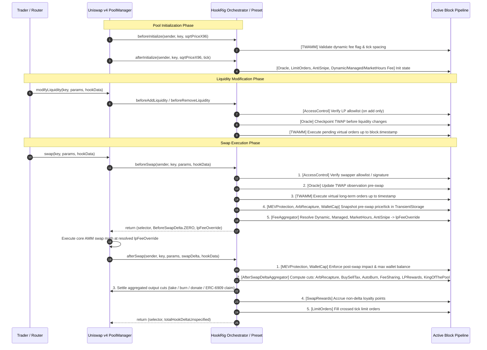
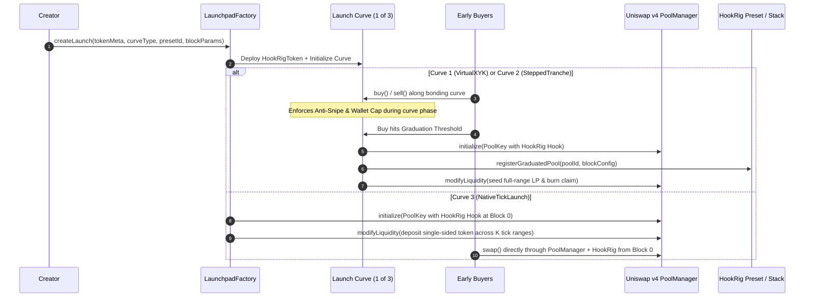

# 03. Hooks Execution Flow & Delta Aggregation

When multiple building blocks are stacked into a single hook (such as the **Treasury-backed token** preset combining 6 blocks, or **Weekly King with buy rewards** combining 6 blocks), their callbacks must execute in a **strict, deterministic order** without clobbering fees or corrupting `BalanceDelta`.

---

## 1. End-to-End Pool & Swap Lifecycle

---

## 2. Callback-by-Callback Execution Pipeline

### 2.1 `beforeInitialize` & `afterInitialize`
| Step | Block | Action Taken |
| :--- | :--- | :--- |
| **1** | **Orchestrator Core** | Validates that `key.fee` has `LPFeeLibrary.DYNAMIC_FEE_FLAG` enabled whenever any Fee or `Anti-snipe` block is in the stack. Locks the pool's block configuration for `PoolId`. |
| **2** | **`TWAMM`** (`beforeInitialize`) | Validates tick spacing constraints required for virtual order intervals. |
| **3** | **`Oracle`** (`afterInitialize`) | Initializes observation ring buffer at `block.timestamp` and initial `tick`. |
| **4** | **`Anti-snipe`** (`afterInitialize`) | Records `launchBlock = block.number` and starting decay parameters. |
| **5** | **`Dynamic` / `Managed` / `Market-hours fee`** (`afterInitialize`) | Sets initial base LP fee on `PoolManager` and initializes volatility/schedule parameters. |
| **6** | **`Limit orders`** (`afterInitialize`) | Records initial active `tickLower`/`tickUpper` anchor for order book indexing. |

---

### 2.2 `beforeAddLiquidity` & `beforeRemoveLiquidity`
| Step | Block | Callback | Action Taken |
| :--- | :--- | :--- | :--- |
| **1** | **`Access control`** | `beforeAddLiquidity` | If LP allowlist is enabled, verifies the authenticated LP address. (**Never** runs on `beforeRemoveLiquidity` so LPs can never be locked in). |
| **2** | **`Oracle`** | Both | Records tick/price checkpoint before liquidity depth changes. |
| **3** | **`TWAMM`** | `beforeAddLiquidity` | Advances virtual order execution to `block.timestamp` so new liquidity does not dilute accrued virtual fills. |

---

### 2.3 `beforeSwap` Flow & Fee Resolution Policy

During `beforeSwap`, four distinct categories of blocks run in sequence:

1. **Gatekeeping (`Access control`)**:
   - Checks if swapper (via trusted router `IMsgSender` or EIP-712 `hookData` signature) is authorized. Reverts immediately if unauthorized.
2. **Pre-Swap State Sync (`Oracle`, `TWAMM`)**:
   - `Oracle` updates the price accumulator using the pre-swap tick (preventing intra-tx manipulation of the oracle checkpoint).
   - `TWAMM` executes any accrued virtual orders since the last timestamp.
3. **Transient Snapshot (`MEV protection`, `Arb recapture`, `Wallet cap`)**:
   - Saves `preSwapSqrtPriceX96` and `preSwapTick` in transient storage (`EIP-1153`) keyed by `PoolId`.
4. **Deterministic `FeeAggregator` (`Dynamic fee`, `Managed fee`, `Market-hours fee`, `Anti-snipe`)**:
   - Because Uniswap v4 accepts a single `uint24 lpFeeOverride` from `beforeSwap`, `hookrig` resolves multiple active fee blocks using the **Dominant Protection Rule (`MAX` capped at `MAX_LP_FEE`)**:

$$f_{\text{resolved}} = \min\Big(\text{MAX\_LP\_FEE},\; \max\big(f_{\text{dynamic}},\; f_{\text{managed}},\; f_{\text{marketHours}},\; f_{\text{antiSnipe}}\big)\Big)$$

   - **Why `MAX`?** During the first $N$ blocks after launch, `Anti-snipe` charges a decaying high fee (e.g., $30\% \to 1\%$). Using `MAX` guarantees that `Anti-snipe` or closed `Market-hours fee` cannot be accidentally undercut by a lower `Dynamic fee` or `Managed fee`, and once `Anti-snipe` decays below the normal `Dynamic fee`, `Dynamic fee` seamlessly takes over.

---

### 2.4 `afterSwap` & `AfterSwapDeltaAggregator` (Single-Pass Output Slicing)

Eight of the 22 blocks (`Arb recapture`, `Buy and sell tax`, `Auto burn`, `Fee sharing`, `LP rewards`, `King of the Pool`, `Referral split`, and `Auto buyback`) plus the static `5 bps` (`0.05%`) **Protocol Royalty** (`PROTOCOL_ROYALTY_BPS = 5` to `PROTOCOL_ROYALTY_RECIPIENT = 0x576e9C47665887298EB39eeaa070Dfc1fF6B960A`) use `afterSwapReturnDelta` to capture a portion of the swap's unspecified currency.

#### How `afterSwapReturnDelta` Works in Uniswap v4
- When `afterSwap` returns `int128 hookDeltaUnspecified > 0`, `PoolManager` reduces the trader's output credit (or increases the trader's input debt on exact-output swaps) by `hookDeltaUnspecified` in the **unspecified currency**, and credits that exact amount to the Hook inside `PoolManager`.
- For **Exact-Input Swaps (`params.amountSpecified < 0`)**:
  - The specified currency is the input token; the **unspecified currency is the output token**.
  - Let $Y_{\text{out}} = \text{uint128}(\text{unspecifiedDelta})$ be the gross output tokens produced by the pool swap.

#### The Single-Pass Waterfall Invariant
Instead of each block calling `PoolManager.take()` or `donate()` separately (which wastes gas and risks rounding drift), `AfterSwapDeltaAggregator` computes each enabled block's slice from $Y_{\text{out}}$ using explicit floor rounding (`Math.mulDiv(Y_out, bps, 10_000, Math.Rounding.Floor)` on exact-input swaps, and `Math.Rounding.Ceil` on exact-output added input cost):

| Order | Block | Trigger Condition | Cut Formula (Exact-Input Floor Rounded) | Settlement Destination |
| :--- | :--- | :--- | :--- | :--- |
| **0** | **`Protocol Royalty`** | Every swap on registered pools | $\Delta_{\text{royalty}} = \lfloor Y_{\text{out}} \times 5 / 10000 \rfloor$ | ERC-6909 claim to `PROTOCOL_ROYALTY_RECIPIENT` (`0x576e...960A`) |
| **1** | **`Arb recapture`** | Price moved past external/TWAP band | $\Delta_{\text{arb}} = \lfloor \text{arbProfit} \times \text{recaptureBps} / 10000 \rfloor$ | Queued in `pendingLPDonation[poolId][currency]` (ERC-6909); flushed via `PoolManager.donate()` in `beforeSwap` on a later block with no LP additions |
| **2** | **`Buy and sell tax`** | Buy (`buyTaxBps > 0`) or Sell (`sellTaxBps > 0`) | $\Delta_{\text{tax}} = \lfloor Y_{\text{out}} \times \text{taxBps} / 10000 \rfloor$ | ERC-6909 claim to `taxRecipient` (always decay-only after registration; passing `address(0)` to `setBuySellTax` preserves current `taxRecipient`) |
| **3** | **`Auto burn`** | Buy swap (`exactInput` only; `exactOutput` buys revert `ExactOutputBuyNotSupported`) | $\Delta_{\text{burn}} = \lfloor Y_{\text{out}} \times \text{burnBps} / 10000 \rfloor$ | `PoolManager.take()` + `ERC20Burnable.burn()` (or `0xdEaD`), burning actual received tokens |
| **4** | **`Fee sharing`** | Every swap | $\Delta_{\text{share}} = \lfloor Y_{\text{out}} \times \text{shareBps} / 10000 \rfloor$ | ERC-6909 claim split to primary/secondary recipients |
| **5** | **`LP rewards`** | Buy swap (`isBuy == true`) | $\Delta_{\text{lp}} = \lfloor Y_{\text{out}} \times \text{lpRewardBps} / 10000 \rfloor$ | Queued in `pendingLPDonation[poolId][currency]` (ERC-6909); flushed via `PoolManager.donate()` in `beforeSwap` on a later block with no LP additions |
| **6** | **`King of the Pool`** | Buy swap (`exactInput` only; `exactOutput` buys revert `ExactOutputBuyNotSupported`) | $\Delta_{\text{king}} = \lfloor Y_{\text{out}} \times \text{potBps} / 10000 \rfloor$ | ERC-6909 claim added to `_kingStates[poolId].currentPotAmount` (untrusted routers contribute to pot without taking the crown) |
| **7** | **`Referral split`** | Every swap (`referralBps > 0`, attributed trader only) | $\Delta_{\text{ref}} = \lfloor Y_{\text{out}} \times \text{referralBps} / 10000 \rfloor$ | ERC-6909 claim to bound referrer |
| **8** | **`Auto buyback`** | Every swap (`buybackBps > 0`) | $\Delta_{\text{bb}} = \lfloor Y_{\text{out}} \times \text{buybackBps} / 10000 \rfloor$ | Accumulated as ERC-6909 reserve; queued into `pendingLPDonation` when project token price drops to/beyond `triggerFloorTick` (`postSwapTick <= triggerFloorTick` when `token0` is project token, `postSwapTick >= triggerFloorTick` when `token1` is project token) |

#### Aggregate Cap & Conservation Check
$$\Delta_{\text{total}} = \Delta_{\text{royalty}} + \Delta_{\text{arb}} + \Delta_{\text{tax}} + \Delta_{\text{burn}} + \Delta_{\text{share}} + \Delta_{\text{lp}} + \Delta_{\text{king}} + \Delta_{\text{ref}} + \Delta_{\text{bb}} \le \lfloor Y_{\text{out}} \times \text{MAX\_AGGREGATE\_AFTER\_SWAP\_BPS} / 10000 \rfloor$$

- Every slice is resolved with `PoolManager` (via batched ERC-6909 `mint`, `burn`, `donate`, or `take`) so that the Hook's net delta with `PoolManager` at the end of `afterSwap` is **strictly zero** after returning `toInt128(Delta_total)`.
- Next, **`Swap rewards`** records swap points on the post-cut net project token volume (on exact-input buys: `grossUnspecifiedAmount - totalCutAmount`; on exact-output sells: `grossUnspecifiedAmount + totalCutAmount`; storage/event only, zero delta).
- Finally, **`Limit orders`** traverses up to `MAX_TICK_FILLS_PER_SWAP = 512` aligned ticks between `preSwapTick` and `postSwapTick` (`zeroForOne == true` triggers on downward tick crossings `t <= prevTick`; `zeroForOne == false` triggers on upward tick crossings `t >= prevTick`), marking epoch-indexed buckets as filled for claim via `claimLimitOrder(key, orderId, minAmountOut)`.

---

## 3. Token Launchpad Curve-to-Hook Flow

