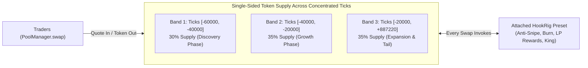
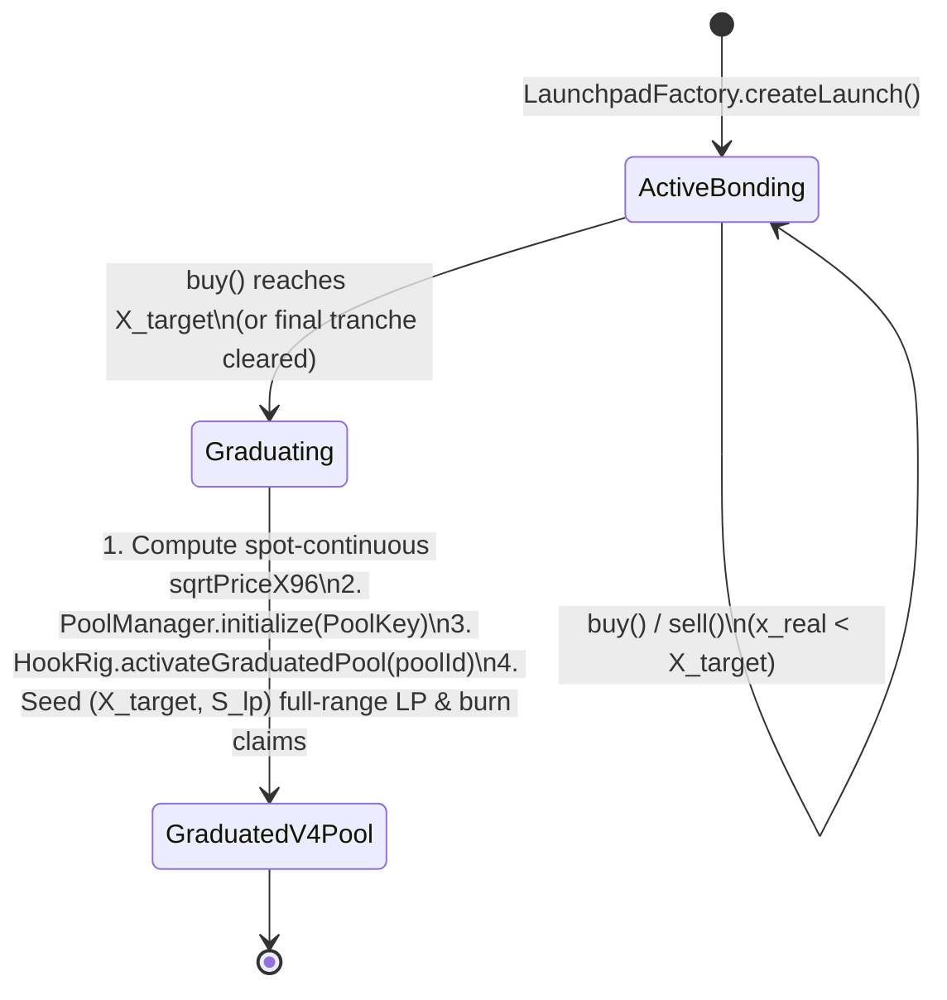

# 05. Token Launchpad Mechanics & Audited Stack

This document specifies the mathematical models, lifecycle state machines, graduation mechanics, and audited dependency stack for the **`hookrig` Token Launchpad Suite**.

Every token launched through `hookrig` is paired with either one of the **12 Curated Presets** or a **Custom HookRig Stack**, ensuring that anti-snipe protections, dynamic fees, LP rewards, burns, or jackpot mechanics (`King of the Pool`) are cryptographically bound to the token from creation.

---

## 1. Audited Stack for the Token Launchpad

Rather than writing custom token, proxy, or math primitives from scratch, the `hookrig` Launchpad is assembled strictly from **formally audited OpenZeppelin and Uniswap libraries**:

| Component | Audited Library / Contract | Security Purpose in `hookrig` Launchpad |
| :--- | :--- | :--- |
| **Launch Token Standard** | `@openzeppelin/contracts/token/ERC20/ERC20.sol` `ERC20Burnable.sol` `ERC20Permit.sol` (EIP-2612) | Standard-compliant, non-rebasing, fixed-supply ERC-20 with audited `burn()` support (used by the `Auto burn` block) and gasless `permit()` approvals. |
| **Gas-Efficient Deployment** | `@openzeppelin/contracts/proxy/Clones.sol` (EIP-1167) & `Create2.sol` | Deterministic, low-gas deployment of Curve instances and deterministic token address mining (so `currency0 < currency1` sort order in Uniswap v4 can be enforced at creation!). |
| **Bonding Curve Math** | `@openzeppelin/contracts/utils/math/Math.sol` (`mulDiv`) & `SafeCast.sol` | 512-bit intermediate precision `mulDiv` with explicit `Math.Rounding.Floor` (tokens out) and `Math.Rounding.Ceil` (quote in) to prevent Bunni-style rounding drains. |
| **v4 Curve & Settlement** | `@openzeppelin/uniswap-hooks/base/BaseCustomCurve.sol` `@openzeppelin/uniswap-hooks/utils/CurrencySettler.sol` | Audited delta settlement (`sync`, `take`, `settle`) handling both ERC-20 quote tokens (USDC) and Native ETH (`CurrencyLibrary.ADDRESS_ZERO`). |
| **Reentrancy & Locks** | `@openzeppelin/contracts/utils/ReentrancyGuardTransient.sol` | EIP-1153 transient reentrancy lock protecting curve `buy()`, `sell()`, and `graduate()` transitions. |
| **Creator / Team Vesting** | `@openzeppelin/contracts/finance/VestingWallet.sol` | Audited linear/cliff vesting vault for optional creator/team allocations. |
| **Allowlist / Presale** | `@openzeppelin/contracts/utils/cryptography/MerkleProof.sol` | Audited Merkle verification when launching with the `Access control` block. |
| **v4 Pool & LP Seeding** | `Uniswap/v4-core` (`PoolManager`) & `v4-periphery` (`PositionManager`, `TickMath`, `SqrtPriceMath`) | Official Uniswap v4 math and liquidity seeding primitives for atomic graduation. |

---

## 2. Deterministic Token Address Mining (Token Sorting Invariant)

In Uniswap v4, every `PoolKey` requires `Currency.unwrap(currency0) < Currency.unwrap(currency1)`.
- When launching a token against Native ETH (`address(0)`), ETH is **always** `currency0` and the launched `HookRigToken` is **always** `currency1`.
- When launching a token against an ERC-20 quote asset (e.g., `USDC` or `WETH`), `LaunchpadFactory` uses `Create2` salt mining so the deployed `HookRigToken` is deterministically placed as `currency1` (`tokenAddress > quoteAddress`).
- **Why this matters**: Standardizing the launched project token as `currency1` makes `zeroForOne == true` universally represent a **Buy** (spending `currency0` quote to receive `currency1` project token) and `zeroForOne == false` universally represent a **Sell**.

---

## 3. The 3 Token Launch Curve Models (Deep Dive)

### Overview Comparison

| Feature | Curve 1: `VirtualXYKLaunch` | Curve 2: `SteppedTrancheLaunch` | Curve 3: `NativeTickLaunch` |
| :--- | :--- | :--- | :--- |
| **Inspiration** | Pump.fun / Virtual Constant Product | Fair-launch Tranche / Anti-Bundle | Direct Uniswap v4 Single-Sided Concentrated |
| **Initial Creator Capital** | $0$ (Virtual Reserves) | $0$ (Stepped Virtual Tranches) | $0$ (Single-Sided Token LP across ticks) |
| **Can Users Sell Before Graduation?** | Yes (along the $x \cdot y = k$ curve) | Yes (with anti-dump exit fee feeding LP reserve) | Yes (directly inside the Uniswap v4 pool) |
| **Migration / Graduation Step?** | Atomic auto-graduation at target quote raised | Atomic auto-graduation when final tranche clears | **None** (Pool is live in `PoolManager` at Block 0) |
| **When Do `hookrig` Blocks Activate?** | At Graduation (`Wallet cap` & `Anti-snipe` enforced on curve too) | At Graduation (`Wallet cap`, `Anti-snipe`, & `King` pot seeded during curve) | **Immediately from Trade #1 (Block 0)** |

---

### Curve 1: `VirtualXYKLaunch` (Virtual Constant-Product Bonding Curve)

#### 1. Supply Partitioning
For a standard total supply $S_{\text{total}} = 1,000,000,000 \times 10^{18}$:
- **Curve Sale Allocation ($S_{\text{curve}}$)**: $80\%$ ($800\text{M}$ tokens) available to buy on the bonding curve.
- **Graduation LP Reserve ($S_{\text{lp}}$)**: $20\%$ ($200\text{M}$ tokens) held locked in the curve contract to pair with the raised quote currency upon graduation.

#### 2. Virtual Reserve Math
The curve initializes with virtual quote reserves $X_0$ (e.g., $1.5\text{ ETH}$) and virtual token reserves $Y_0 = S_{\text{curve}} + S_{\text{lp\_virtual}}$ (e.g., $1,073,000,000$ tokens), maintaining the invariant:

$$(X_0 + x_{\text{real}}) \cdot Y_{\text{virtual}} = k, \quad \text{where } k = X_0 \cdot Y_0$$

- **Buying $\Delta y$ tokens with $\Delta x$ net quote input**:
  $$\Delta y = \left\lfloor Y_{\text{virtual}} - \frac{k}{(X_0 + x_{\text{real}}) + \Delta x} \right\rfloor \quad (\text{rounded DOWN via } \texttt{Math.Rounding.Floor})$$
- **Selling $\Delta y$ tokens for $\Delta x$ quote output**:
  $$\Delta x = \left\lfloor (X_0 + x_{\text{real}}) - \frac{k}{Y_{\text{virtual}} + \Delta y} \right\rfloor \quad (\text{rounded DOWN via } \texttt{Math.Rounding.Floor})$$

#### 3. Cap-and-Refund at Graduation Threshold
When a buyer submits $\Delta x$ that would push $x_{\text{real}} + \Delta x > X_{\text{target}}$ (or sell more than the remaining $S_{\text{curve}}$ tokens):
1. The curve consumes **only** $\Delta x_{\text{used}} = X_{\text{target}} - x_{\text{real}}$ to purchase the exact remaining curve tokens.
2. The excess quote $\Delta x_{\text{excess}} = \Delta x - \Delta x_{\text{used}}$ is immediately refunded to the buyer (or optionally swapped into the newly graduated v4 pool in the same transaction).
3. `graduate()` executes atomically in the same transaction.

---

### Curve 2: `SteppedTrancheLaunch` (Anti-Bundle Community Accumulation Curve)

Designed for launches where preventing block-0 sniper bundles from acquiring the majority of supply at the lowest price is paramount.

#### 1. Tranche & Time-Damped Structure
- $S_{\text{curve}}$ ($800\text{M}$ tokens) is partitioned into $M$ discrete price tranches (e.g., $M = 10$ tranches of $80\text{M}$ tokens each), where tranche $i$ has a fixed or linearly increasing marginal price $P_i$:
  $$P_i = P_0 \cdot (1 + \alpha \cdot i)$$
- **Built-In Curve Protections**:
  - **Per-Wallet Cap During Bonding**: Enforces `maxWalletBps` (e.g., $1.5\%$ of total supply per wallet) directly inside `buy()`.
  - **Sniper Decay Surcharge**: During the first $N$ blocks after launch creation, buyers pay an `antiSnipeBps` surcharge on top of $P_i$.
  - **Value Accretion**: $100\%$ of sniper surcharges collected during the bonding phase are split between:
    1. **Extra Graduation LP Depth** (increasing the backing floor price of the token in v4), or
    2. **Seeding the Round #1 `King of the Pool` Jackpot Pot** when paired with *King of the Pool launch* or *Weekly King with buy rewards*!

---

### Curve 3: `NativeTickLaunch` (Zero-Migration Direct Uniswap v4 Curve)

Designed for builders who want **100% native Uniswap v4 execution from Block 0** with zero migration transaction.

#### How It Works
1. `LaunchpadFactory` deploys `HookRigToken` (with `currency0 = Quote`, `currency1 = Token`) and immediately calls `PoolManager.initialize(key, initialSqrtPriceX96)` with the chosen `hookrig` hook address attached.
2. Since `Token` is `currency1`, single-sided `currency1` liquidity can be minted in concentrated tick ranges strictly **below** the current tick (if price is `currency1/currency0`) or **above** depending on orientation, such that the pool holds $100\%$ project tokens and $0$ quote tokens at initialization.
3. `LaunchpadFactory` deposits the supply across $K$ adjacent tick bands (`Band 1..K`) matching the desired bonding curve slope, and locks the LP claims permanently inside the Launchpad vault.
4. **Immediate Hook Execution**: Every buy from Block 0 is a standard `PoolManager.swap()`, meaning `Anti-snipe`, `Dynamic fee`, `Auto burn`, `LP rewards`, `King of the Pool`, and `Swap rewards` execute natively from the very first trade.

---

## 4. Atomic Graduation State Machine (Curves 1 & 2)

### The 4 Graduation Security Invariants

1. **Spot-Price Continuity (Zero Graduation Arbitrage)**:
   - Let $P_{\text{final}}$ be the marginal price of the final token sold on the bonding curve.
   - The graduation reserve ratio $(X_{\text{lp}}, S_{\text{lp}})$ and the initial v4 pool price `sqrtPriceX96` are parameterized at launch creation such that:
     $$\left(\frac{\texttt{sqrtPriceX96}}{2^{96}}\right)^2 = \frac{S_{\text{lp}}}{X_{\text{lp}}} = P_{\text{final}}$$
   - This eliminates any instantaneous arbitrage jump between the final curve trade and the first Uniswap v4 swap.
2. **Pre-Initialization Front-Running Lock**:
   - In `HookRigBase.beforeInitialize`, if a `PoolKey` contains a token deployed by `LaunchpadFactory`, `beforeInitialize` verifies `sender == address(launchpadFactory) || sender == authorizedCurve[key.toId()]`.
   - Nobody can front-run `PoolManager.initialize()` with a manipulated `sqrtPriceX96`.
3. **Post-Graduation `Anti-snipe` Clock Reset**:
   - When a token graduates from Curve 1 or Curve 2 into Uniswap v4, the `Anti-snipe` block's $N$-block decay timer starts at **`graduationBlock = block.number`**, protecting the newly seeded v4 pool during its first $N$ blocks of AMM trading.
4. **Irreversible LP Burn**:
   - The LP position minted during graduation is held as locked ERC-6909 liquidity claims (or burned to `0xdead`), ensuring the base liquidity floor can never be rugged by the token creator.
